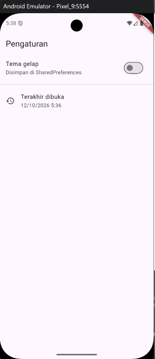
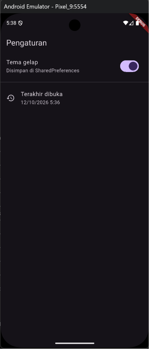
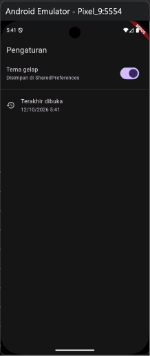
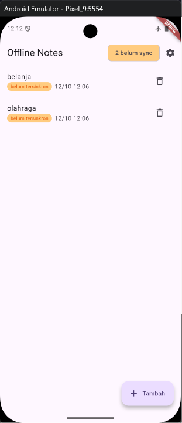
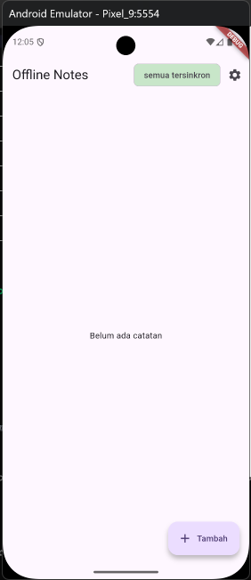
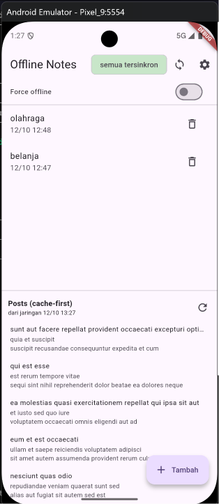
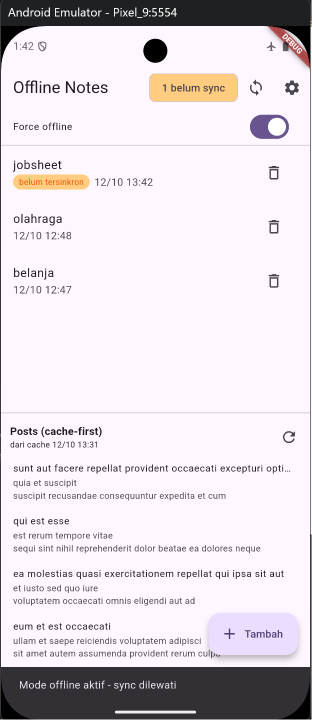
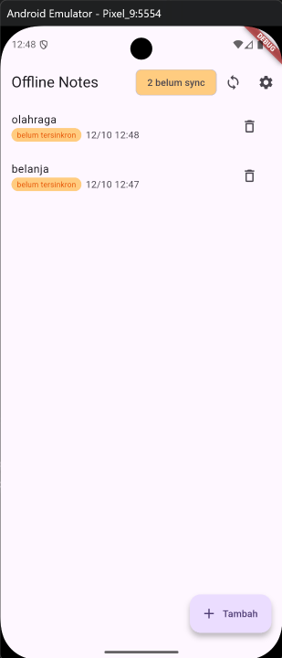
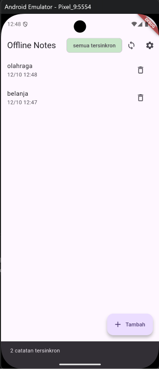
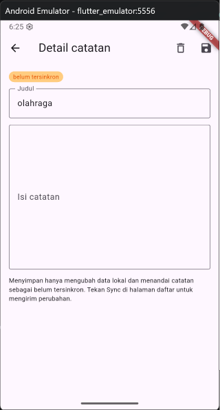

# Minggu 5 — Local Storage & Offline First

### Tujuan

Mini project ini dibuat untuk memahami penyimpanan lokal dan pola offline-first di perangkat. Secara spesifik, project ini bertujuan untuk membedakan kapan memakai penyimpanan key-value, relasional, dan NoSQL; menyimpan preferensi aplikasi memakai SharedPreferences; menerapkan CRUD catatan dengan SQLite melalui repository lokal; menerapkan pola offline-first (cache-first read, dirty flag, dan antrean sinkronisasi); menampilkan state loading, error, empty, dan success memakai Riverpod; serta menguji repository lokal memakai repository palsu tanpa database sungguhan.

---

### Fitur Utama

Aplikasi ini adalah aplikasi catatan (Offline Notes) yang tetap bisa dibaca dan ditulis tanpa internet, lalu disinkronkan saat online. Fitur:

- Preferensi tema gelap/terang dan waktu terakhir dibuka (SharedPreferences)
- CRUD catatan yang persisten dengan SQLite (sqflite), daftar diurutkan `updated_at` terbaru
- Badge "belum tersinkron" per catatan dan chip ringkasan antrean sync di AppBar
- Antrean sinkronisasi: setiap catatan ditandai bersih satu per satu, hanya setelah "server" menerimanya
- Cache-first read untuk data bacaan (`GET /posts`): tampilkan cache dulu, refresh di background
- Toggle **Force offline** untuk demo offline yang deterministik
- Halaman detail catatan (`/note/:id`) untuk mengubah dan menghapus
- Empat state UI: loading, error, empty, dan success

---

### Stack Teknologi

- Flutter 3.47.2 (Dart 3.13.2)
- sqflite 2.4.4+1 (SQLite untuk catatan dan cache)
- shared_preferences 2.5.6 (preferensi)
- Riverpod 3.4.3 (state management)
- Dio 5.11.1 (HTTP client)
- GoRouter 18.0.2 (deklaratif routing)
- path 1.9.1 (penyusunan path lintas platform)
- JSONPlaceholder (API dummy)
- flutter_test (unit testing)

---

### Cara Menjalankan

```bash
cd 05-week-5-local-storage-offline-first
flutter pub get
flutter run
```

Untuk menjalankan pemeriksaan:

```bash
flutter analyze
flutter test
```

> Aplikasi memakai `sqflite`, jadi jalankan di emulator atau perangkat Android, bukan desktop.

---

### Hasil yang Dicapai

#### Praktikum 1 — Preferensi (SharedPreferences)

Seluruh akses key-value dipusatkan di `PrefsRepository`, sehingga widget tidak pernah memanggil plugin SharedPreferences secara langsung. `darkModeProvider` dibuat sebagai `AsyncNotifier` karena nilai awalnya dibaca dari disk, sedangkan `lastOpenedProvider` cukup `FutureProvider` karena hanya dibaca. Waktu terakhir dibuka dicatat di `main()` sebelum `runApp`, supaya frame pertama sudah punya nilainya.

Tema bertahan setelah aplikasi ditutup dan dibuka kembali — dibuktikan dengan membandingkan jam di status bar dan nilai "Terakhir dibuka" antara sesi sebelum dan sesudah restart.





#### Praktikum 2 — Catatan Lokal (Model, Database, Repository)

Model `Note` memakai `toMap`/`fromMap` dengan cast defensif (`as num?`, `?? ''`, `DateTime.tryParse`), sehingga satu baris data yang rusak tidak menggagalkan pembacaan seluruh daftar. `updated_at` disimpan sebagai `TEXT` ISO-8601 agar urutan `ORDER BY` sama dengan urutan waktu, dan `dirty` sebagai `INTEGER` 0/1 karena SQLite tidak punya tipe boolean.

`openNotesDb()` membuka database dengan `version: 1` dan `onCreate` yang membuat dua tabel: `notes` dan `cached_posts`. `NoteRepository` menjadi satu-satunya pintu ke tabel `notes`, dan fungsi pembuka database **disuntikkan lewat konstruktor** sehingga test dapat memakai repository palsu tanpa menyentuh SQLite.

#### Praktikum 3 — Halaman Catatan Offline

`NotesNotifier` adalah satu-satunya pemilik daftar catatan: semua mutasi (tambah, ubah, hapus, sync) dirutekan lewat sana, dan setiap mutasi diakhiri pembacaan ulang dari database. Dengan begitu tidak ada jalur yang lupa menyegarkan tampilan. Jumlah catatan belum tersinkron dihitung **dari daftar yang sama** (`dirtyCountProvider`), bukan lewat query terpisah, supaya chip dan badge tidak pernah bercerita berbeda.

Halaman memakai `AsyncValue.when()` untuk menangani keempat state: loading (spinner), error (pesan), empty ("Belum ada catatan"), dan success (daftar). Baris catatan dipecah menjadi widget `NoteTile` dengan badge "belum tersinkron" saat `dirty == true`.




#### Praktikum 4 — Offline-First (Cache-first, Antrean Sync, Simulasi Offline)

**Cache-first read.** `PostsNotifier` membaca tabel `cached_posts` lebih dulu sehingga layar langsung terisi, lalu me-refresh dari jaringan di background dan menimpa cache. Kalau jaringan gagal, daftar yang sudah tampil **tidak dikosongkan** — hanya statusnya yang jujur berubah. UI selalu menampilkan asal data ("dari jaringan" / "dari cache ‹waktu›") supaya perilaku offline bisa dibuktikan lewat screenshot, bukan diasumsikan.

**Antrean sinkronisasi.** Setiap perubahan lokal menandai baris `dirty = 1`. `syncNotes()` membaca antrean itu urut `updated_at ASC` (perubahan terlama lebih dulu) dan menandai setiap catatan bersih **satu per satu, hanya setelah "server" menerimanya**. Versi contoh codelab memakai `markAllSynced()` yang menandai semua baris sekaligus; itu membuat catatan yang gagal ikut dianggap terkirim dan tidak akan pernah dicoba lagi, jadi di sini penandaan dilakukan per baris.

**Simulasi offline.** Toggle `forceOffline` memaksa aplikasi memakai jalur offline tanpa bergantung pada kondisi Wi-Fi, sehingga demo dan screenshot hasilnya deterministik. Saat aktif, sync dijawab "Mode offline aktif - sync dilewati" dan badge dirty tidak turun — antreannya benar-benar tertahan sampai online.

Aturan konflik yang dipakai eksplisit: **last-write-wins berdasarkan `updated_at`**.






#### AI Challenge

Membandingkan SharedPreferences, Hive, sqflite, dan Drift untuk dua kebutuhan aplikasi (preferensi dan catatan), lengkap dengan skema untuk 1000+ catatan. Empat temuan dari AI Verification Checklist:

1. **Apakah AI menaruh daftar catatan di SharedPreferences?** Tidak. AI menaruh preferensi di SharedPreferences dan catatan di Drift — pemisahan yang benar. Diterima.
2. **Apakah skema AI mendukung antrean sync?** Tidak lengkap. `updatedAt` ada (cukup untuk urutan dan aturan konflik), tetapi penanda antrean seperti `dirty` tidak ada. Penyebabnya bisa ditelusuri: prompt-nya sendiri tidak menyebut offline-first, sehingga AI tidak punya dasar menambahkannya. Kolom `dirty` ditambahkan sendiri.
3. **Apakah klaim "real-time" didukung stream?** Ya. `watch()` disebut eksplisit untuk Drift dan `box.watch()` untuk Hive, bukan sekadar diklaim. Diterima sebagai fakta, tetapi tidak dipakai di project ini.
4. **Apakah estimasi boilerplate masuk akal?** Diukur langsung, bukan diperkirakan: 29 baris yang ditulis menghasilkan 487 baris yang digenerate, ditambah satu langkah codegen wajib (~87 detik pada run pertama ~152 detik). Kategori "paling besar di awal" benar, tetapi bobotnya jauh lebih besar daripada kesan kalimat itu.

Atas dasar temuan di atas, Drift ditolak untuk aplikasi satu tabel ini. Prompt, tabel perbandingan, hasil verifikasi lengkap, dan keputusan akhirnya ada di [`docs/ai-challenge.md`](docs/ai-challenge.md).

#### Refactoring dan Testing

Tiga refactoring dikerjakan: baris catatan diekstrak menjadi widget `NoteTile`; logika cache posts dan `syncNotes` dipindahkan ke `lib/data/sync.dart` agar kedua repository tetap fokus (satu CRUD, satu jaringan); dan halaman detail ditambahkan dengan GoRouter (`/note/:id`) yang membaca dari repository lokal, bukan dari state halaman daftar — sehingga deep link tetap bekerja sendiri.

Testing memakai repository palsu yang `super(openDb: () => throw UnimplementedError())`: fungsi pembuka database sengaja dibuat melempar, sehingga test gagal keras kalau ada jalur kode yang mencoba menyentuh SQLite sungguhan. Enam test dibuat untuk memverifikasi parsing aman-null, serialisasi `dirty`, perilaku antrean sync (membuktikan penandaan benar-benar per baris), dan state sukses serta error pada provider.

Kendala yang ditemukan: test "provider error" gagal karena timeout. Penyebabnya Riverpod 3 otomatis mencoba ulang provider yang gagal (sampai 10 kali dengan backoff), sehingga `.future` menggantung alih-alih melempar. Diperbaiki dengan `ProviderContainer(retry: (_, _) => null)`.

#### Mini Project

Seluruh praktikum digabung menjadi satu aplikasi Offline Notes: preferensi tema, CRUD catatan persisten, antrean sinkronisasi, cache-first read, simulasi offline, halaman detail, dan empat state UI. Aplikasi telah diverifikasi dengan `flutter analyze` (0 issues) dan `flutter test` (6 tests passed, semuanya lulus).



#### Refleksi

1. Mengapa daftar catatan tidak boleh disimpan di SharedPreferences? Apa yang rusak jika aturan ini dilanggar?
> SharedPreferences menyimpan satu nilai per key dan hanya mendukung tipe primitif, jadi koleksi harus di-encode menjadi satu string. Akibatnya: mengubah satu catatan menulis ulang seluruh koleksi sehingga satu kegagalan tulis dapat menghilangkan semuanya; tidak ada `ORDER BY` maupun `WHERE` sehingga urut dan filter harus dikerjakan di memori setiap kali daftar dibaca; dan dua penulis yang berjalan bersamaan dapat saling menimpa (lost update) tanpa error apa pun.

2. Kapan cache-first cukup, dan kapan Anda membutuhkan strategi lain (misalnya network-first untuk data harga real-time)?
> Cache-first cukup untuk data yang toleran terhadap sedikit kebasian, misalnya feed berita atau katalog — keuntungannya layar langsung terisi dan tetap bisa dibaca saat offline. Network-first diperlukan ketika data yang basi bisa menyesatkan: harga saham, skor pertandingan live, atau chat. Di project ini posts memakai cache-first, dan UI selalu menampilkan asal data beserta waktunya supaya pengguna tahu seberapa segar data yang dilihatnya.

3. Bagaimana dirty flag berubah menjadi antrean sync tanpa memblokir UI? Kapan antrean terpisah (tabel outbox) menjadi perlu?
> Setiap perubahan lokal menandai baris `dirty = 1`, dan flag itulah yang membentuk antrean. `syncNotes()` membacanya urut `updated_at ASC` lalu mengirim satu per satu; UI tidak menunggu karena sync dipicu tombol dan setiap langkah hanya menandai satu baris. Tabel outbox terpisah menjadi perlu ketika salah satu dari ini muncul: penghapusan harus ikut tersinkron (sekarang barisnya hilang sehingga tidak bisa dikirim ulang), setiap operasi butuh percobaan ulang atau urutan sendiri, atau perlu metadata per operasi seperti jumlah percobaan dan error terakhir.

4. Bagian mana dari rekomendasi AI yang Anda tolak, dan mengapa?
> Skema yang diusulkan AI hanya berisi kolom CRUD tanpa penanda antrean sync; prompt-nya sendiri tidak menyebut offline-first sehingga AI tidak punya dasar menambahkannya. Saya menambahkan kolom `dirty`. Saya juga menolak Drift untuk catatan dan memilih sqflite: aplikasi ini hanya punya satu tabel dan satu antrean sederhana, sementara Drift memerlukan 487 baris kode yang digenerate untuk 29 baris yang ditulis, ditambah satu langkah codegen setiap kali skema berubah. Konsekuensinya saya terima sadar dan didokumentasikan di `docs/ai-challenge.md`.
