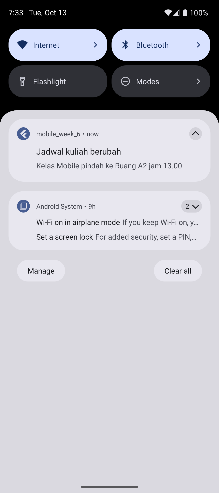
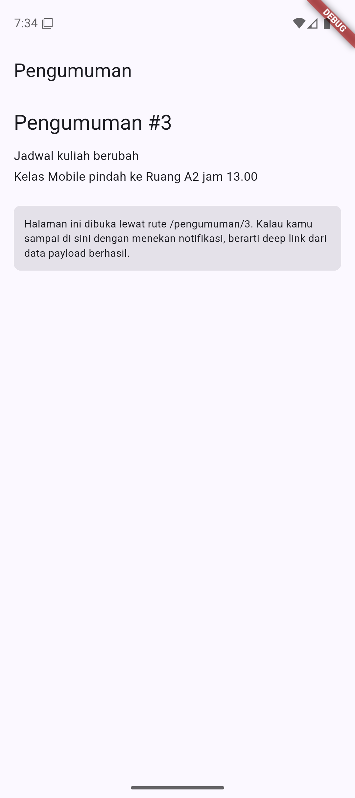
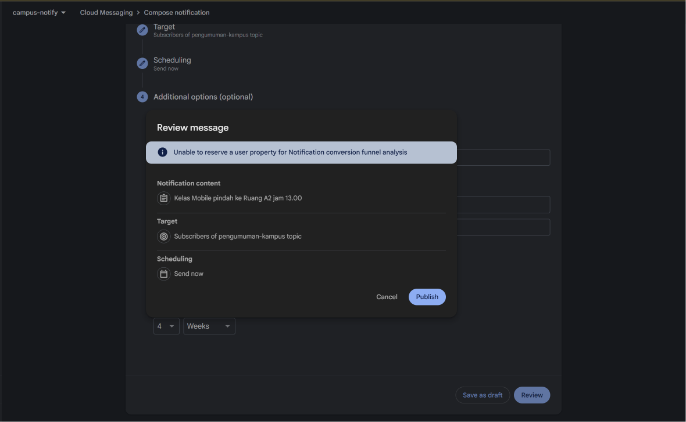
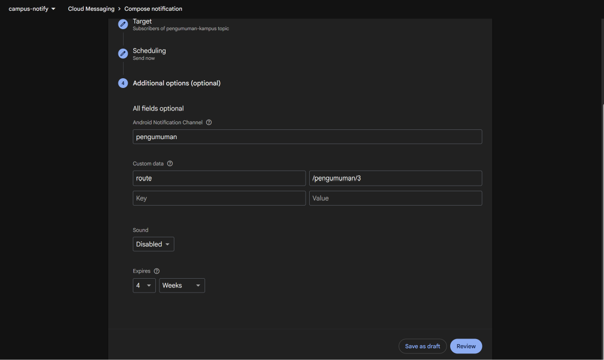
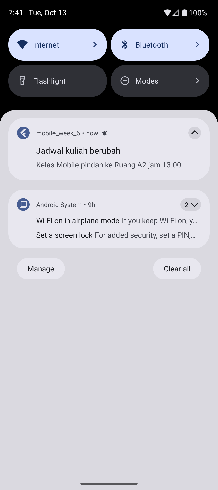
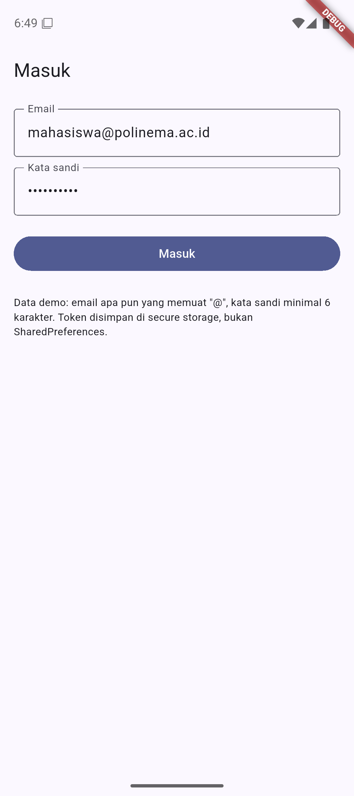
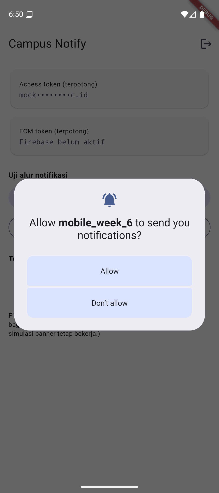
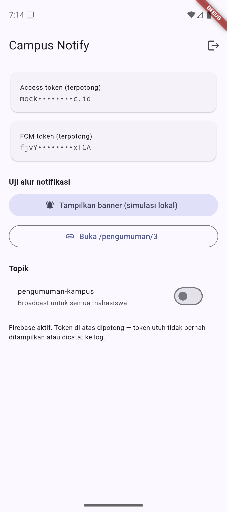

# Minggu 6 — Authentication, Security & FCM

### Tujuan

Mini project ini dibuat untuk memahami autentikasi dan keamanan aplikasi mobile serta alur notifikasi push. Secara spesifik, project ini bertujuan untuk menjelaskan alur autentikasi dan perbedaan ID token, access token, serta refresh token; menyimpan token dengan aman dan menerapkan refresh otomatis; menjelaskan arsitektur FCM; meminta izin notifikasi dan mengelola siklus hidup token; membedakan notification payload dan data payload pada tiga state aplikasi; menangani klik notifikasi sebagai deep link dengan GoRouter; serta menerapkan prinsip keamanan dasar (tidak menanam secret di kode, tidak mencatat token utuh ke log).

---

### Fitur Utama

Aplikasi ini adalah Campus Notification App: pengguna masuk lebih dulu, sesinya bertahan lewat token yang tersimpan aman, dan notifikasi pengumuman kampus membuka halaman yang tepat saat diklik. Fitur:

- Login dengan guard route: belum login selalu diarahkan ke `/login`
- Token disimpan di **secure storage**, bukan SharedPreferences
- Dio dengan **refresh otomatis sekali** saat menerima 401, lalu mengulang request
- Refresh ikut mati → sesi dibersihkan dan pengguna dipaksa login ulang
- Izin notifikasi runtime, `getToken` + `onTokenRefresh` dikirim ke backend, dan langganan topik `pengumuman-kampus`
- Foreground: banner ditampilkan **manual** lewat local notification
- Background & terminated: klik notifikasi membuka `/pengumuman/:id` melalui `data.route`
- Token selalu ditampilkan dan dicatat dalam bentuk **terpotong**
- Tombol simulasi banner di dalam aplikasi, supaya alur banner + deep link bisa diuji tanpa project Firebase

---

### Stack Teknologi

- Flutter 3.47.2 (Dart 3.13.2)
- flutter_secure_storage 11.2.0 (penyimpanan token)
- firebase_core 4.15.0 + firebase_messaging 16.7.0 (FCM)
- flutter_local_notifications 22.3.2 (banner foreground)
- Riverpod 3.4.3 (state management)
- Dio 5.11.1 (HTTP client + interceptor refresh)
- GoRouter 18.0.2 (routing + guard)
- flutter_test (unit testing)

---

### Cara Menjalankan

```bash
cd 06-week-6-authentication-security-fcm
flutter pub get
flutter run
```

Untuk menjalankan pemeriksaan:

```bash
flutter analyze
flutter test
```

> Aplikasi berjalan **tanpa** konfigurasi Firebase. Fitur FCM dinonaktifkan otomatis
> dan aplikasi mencatat alasannya di log; tombol simulasi banner tetap bekerja.
> Untuk mengaktifkan FCM sungguhan, ikuti bagian berikut.

---

### Mengaktifkan FCM

Aplikasi berjalan **tanpa** Firebase; fitur FCM menyala sendiri setelah langkah ini.
Butuh emulator dengan **Google Play Services** dan **Play Store**, atau perangkat fisik —
emulator tanpa keduanya tidak akan pernah menerbitkan token.

1. Buat project di [Firebase Console](https://console.firebase.google.com/) (paket Spark,
   tanpa kartu kredit), lalu tambahkan aplikasi **Android** dengan package name **persis**
   `com.example.mobile_week_6`. **SHA-1 tidak perlu diisi** — itu hanya untuk Google Sign-In.
2. Unduh `google-services.json`, taruh di **`android/app/`** — bukan di `android/`.
3. Aktifkan plugin Gradle:

   ```kotlin
   // android/settings.gradle.kts, di dalam blok plugins { ... }
   id("com.google.gms.google-services") version "4.4.4" apply false

   // android/app/build.gradle.kts, tepat setelah blok plugins { ... }
   apply(plugin = "com.google.gms.google-services")
   ```

4. Hentikan aplikasi sepenuhnya (bukan hot reload), lalu `flutter run`. Beranda akan
   menampilkan **FCM token**; kalau masih tertulis "Firebase belum aktif", ulangi langkah 3.

#### Mengirim notifikasi uji

Firebase Console → **Messaging** → **Create your first campaign** → **Firebase
Notification messages**. Untuk uji berikutnya, pakai **Duplicate** agar isian tersalin.

| Bagian | Isi |
| --- | --- |
| Notification | title `Jadwal kuliah berubah` · text `Kelas Mobile pindah ke Ruang A2 jam 13.00` |
| Additional options → Android Notification Channel | `pengumuman` |
| Additional options → Custom data | `route` = `/pengumuman/3` — **wajib**, ini sumber deep link |
| Target | Topic `pengumuman-kampus` |
| Scheduling | **Send now** |

#### Hasil uji tiga state

| State | Cara uji | Hasil |
| --- | --- | --- |
| Foreground | aplikasi terbuka, kirim dari console | ✅ banner lokal muncul, klik masuk `/pengumuman/3` |
| Background | tekan Home, kirim, klik banner | ✅ banner sistem muncul, klik masuk `/pengumuman/3` |
| Terminated | matikan proses aplikasi, kirim, klik banner | ✅ aplikasi terbuka langsung di `/pengumuman/3` via `getInitialMessage` |

Log dan screenshot pembuktiannya ada di bagian **Hasil yang Dicapai**.

> ⚠️ **Jangan pakai `adb shell am force-stop` untuk mensimulasikan state terminated.**
> Perintah itu menandai paket sebagai *stopped*, dan Android memblokir **semua**
> broadcast — termasuk FCM — sampai aplikasi dibuka lagi oleh user. Gejalanya
> menyesatkan: pesan tidak pernah sampai, terlihat persis seperti bug kode. Pakai swipe
> dari Recent apps, atau `adb shell am kill <package>` setelah aplikasi di background.

> Banner foreground **tidak muncul otomatis** — itu perilaku Android untuk pesan
> bertipe `notification` saat aplikasi terbuka, jadi aplikasi ini menampilkannya manual.
> Kalau banner tidak muncul, periksa izin notifikasi lebih dulu.

---

### Hasil yang Dicapai

#### Praktikum 1 — Penyimpanan Token yang Aman

`TokenStore` memusatkan seluruh lalu lintas token: `save`, `readAccess`,
`readRefresh`, dan `clear`. Token disimpan lewat `flutter_secure_storage`, yang
memakai Keystore di Android dan Keychain di iOS. Refresh token **tidak** ditaruh di
SharedPreferences karena SharedPreferences hanyalah file biasa di sandbox aplikasi —
mudah terbaca pada perangkat yang di-root atau lewat backup. Secure storage terikat
ke perangkat dan tidak ikut isi backup aplikasi.

`TokenStore.mask()` memotong token menjadi 4 karakter awal dan 4 karakter akhir,
sehingga token utuh tidak pernah muncul di log maupun screenshot.

#### Praktikum 2 — Auth Repository dan Guard Route

`AuthRepository` adalah tiruan yang sudah siap diganti Firebase Auth: titik
penggantinya hanya method `login`, sedangkan `TokenStore`, interceptor 401, dan guard
route tidak perlu berubah. `authStateProvider` membaca keberadaan access token di
secure storage, sehingga sesi bertahan setelah aplikasi ditutup.

Guard dipasang di GoRouter lewat `redirect` + `refreshListenable`: pengguna yang belum
login selalu diarahkan ke `/login`, dan pengguna yang sudah login tidak bisa kembali ke
halaman login. Aplikasi menahan tampilan sebentar selagi status login dibaca, supaya
tidak sempat terlempar ke `/login` padahal sesi masih tersimpan.

#### Praktikum 3 — Dio dengan Refresh Otomatis

Interceptor `onRequest` menambahkan header `Authorization: Bearer <access>`. Saat
respons 401, `onError` menukar refresh token menjadi access token baru, menyimpannya,
lalu **mengulang request satu kali**. Kalau refresh ikut kedaluwarsa, sesi dibersihkan
sehingga pengguna dipaksa login ulang.

Penanda `requestOptions.extra['retried']` ditambahkan supaya percobaan ulang tidak
berubah menjadi lingkaran 401 yang tak berujung — request hasil retry yang juga 401
tidak akan memicu refresh lagi.

#### Praktikum 4 — FCM: Izin, Siklus Token, dan Topik

Izin notifikasi diminta saat runtime (wajib di Android 13+ dan iOS). `initFcmToken`
mengambil token lewat `getToken()`, mengirimnya ke backend, memasang listener
`onTokenRefresh`, lalu berlangganan topik `pengumuman-kampus`.

Listener `onTokenRefresh` bersifat wajib: token berubah setelah reinstall, clear data,
atau rotasi keamanan. Tanpa listener itu, backend menyimpan token basi dan notifikasi
berhenti terkirim tanpa error apa pun.

Background handler dibuat sebagai fungsi top-level dengan `@pragma('vm:entry-point')`
karena berjalan di isolate terpisah; di dalamnya tidak ada akses ke `BuildContext`
maupun Riverpod.

#### Praktikum 5 — Tiga State Notifikasi dan Deep Link

Payload yang dipakai selalu gabungan `notification` + `data`, dengan `data.route`
menunjuk `/pengumuman/:id`. Ketiga state bermuara ke satu fungsi navigasi:

| State | Handler | Perlakuan |
| --- | --- | --- |
| Foreground | `FirebaseMessaging.onMessage` | Banner **tidak** muncul otomatis → ditampilkan manual lewat `flutter_local_notifications` |
| Background | `FirebaseMessaging.onMessageOpenedApp` | Banner sistem muncul otomatis; klik → navigasi |
| Terminated | `FirebaseMessaging.instance.getInitialMessage()` | Dipanggil setelah router siap, lalu navigasi |

Klik banner foreground masuk lewat `onDidReceiveNotificationResponse`, yang memanggil
callback `onDeepLinkRequested`. Dengan begitu `PushService` tidak perlu tahu apa pun
soal router.




#### Matriks Pengujian FCM

Diisi setelah Firebase aktif. Kirim pesan yang sama dari Firebase Console dengan data
payload `route` = `/pengumuman/3`.

| State | Yang diharapkan | Cara uji | Hasil |
| --- | --- | --- | --- |
| Foreground | Banner lokal muncul, klik masuk ke `/pengumuman/3` | Aplikasi terbuka, kirim dari console | — |
| Background | Banner sistem muncul, klik masuk ke rute yang benar | Tekan Home, kirim, klik banner | — |
| Terminated | Aplikasi terbuka ke rute yang benar via `getInitialMessage` | Swipe-close aplikasi, kirim, klik banner | — |






#### AI Challenge

Draf awal AI sudah benar pada struktur, tetapi salah pada detail yang hanya ketahuan
setelah dijalankan: API `flutter_local_notifications` 22 sudah berpindah ke named
parameter (termasuk `details` → `notificationDetails`), `DioExceptionType` di dio 5.11
menambah nilai `transformTimeout` sehingga `switch` tidak lagi lengkap, dan
`flutter_local_notifications` mewajibkan core library desugaring di Gradle. Interceptor
401 juga diperbaiki agar tidak berulang, parsing route diperketat, dan Firebase dibuat
tahan gagal supaya project tetap bisa dijalankan tanpa `google-services.json`.

Sebelas perbaikan beserta alasannya ada di [`docs/ai-challenge.md`](docs/ai-challenge.md).

#### Refactoring dan Testing

Tiga refactoring dikerjakan sesuai codelab: seluruh path rute dipusatkan di
`lib/routes.dart`; parsing `RemoteMessage` → route dijadikan fungsi murni
`routeFromMessage()`; dan pemetaan `DioException` → pesan ramah pengguna dipindahkan ke
`lib/data/api_errors.dart`, sehingga UI hanya menerima pesan dan tidak pernah menyentuh
exception jaringan mentah.

Enam belas unit test dibuat tanpa menyentuh Firebase maupun secure storage: parsing
route (termasuk route kosong, tanpa slash, berspasi, dan URL eksternal yang harus
ditolak), penyamaran token, logika sesi dan refresh, serta pemetaan pesan error.
Aplikasi telah diverifikasi dengan `flutter analyze` (0 issues) dan `flutter test`
(16 tests passed).

Kendala yang ditemukan saat build: `flutter_local_notifications` memerlukan core
library desugaring, dan cache incremental Kotlin gagal karena pub cache berada di drive
`C:` sedangkan project di drive `D:` — diselesaikan dengan `kotlin.incremental=false`.

#### Mini Project

Seluruh praktikum digabung menjadi aplikasi Campus Notification App: login dengan guard
route, token di secure storage, refresh otomatis pada 401, integrasi FCM, deep link
`/pengumuman/:id` pada ketiga state, dan tooling keamanan dasar.

Hasil verifikasi yang benar-benar dijalankan di emulator Android 16 (API 36):

| Yang diuji | Hasil |
| --- | --- |
| `flutter analyze` | 0 issues |
| `flutter test` | 16 test lulus |
| `flutter build apk --debug` | berhasil |
| Aplikasi dibuka tanpa token | diarahkan ke `/login` oleh guard route |
| Login berhasil | pindah ke beranda; access token tampil terpotong |
| Aplikasi di-restart | langsung ke beranda — sesi bertahan di secure storage |
| Izin notifikasi (tanpa Firebase) | dialog izin muncul, diminta lewat `flutter_local_notifications` |
| Klik banner foreground | membuka `/pengumuman/3` — dibuktikan lewat log dan layar |
| FCM sungguhan pada 3 state (foreground, background, terminated) | ✅ ketiganya berhasil; klik masuk ke `/pengumuman/3` |

Perilaku klik ini juga terekam di log, sehingga bisa dibuktikan tanpa menebak:

```
[PUSH] deep link diminta: /pengumuman/3 (handler=true)
[PUSH] navigasi ke: /pengumuman/3
```

Fitur FCM aktif otomatis setelah `google-services.json` ditambahkan.





#### Refleksi

1. Mengapa refresh token tidak boleh disimpan di SharedPreferences? Apa risikonya bila bocor?
> SharedPreferences hanyalah file XML di sandbox aplikasi, tanpa kunci yang terikat perangkat, sehingga isinya bisa dibaca pada perangkat yang di-root atau lewat backup. Kalau refresh token bocor, penyerang bisa menukarnya menjadi access token baru kapan saja selama masa berlakunya — dan itu berarti akses penuh ke akun pengguna tanpa perlu tahu kata sandinya. Karena umur refresh token panjang (di codelab ini 7 hari), dampaknya jauh lebih besar daripada bocornya access token yang berumur pendek.

2. Apa yang rusak bila `onTokenRefresh` diabaikan selama satu semester perkuliahan?
> Token FCM berubah ketika aplikasi dipasang ulang, datanya dibersihkan, atau dipulihkan ke perangkat baru. Kalau listener itu tidak ada, backend tetap memegang token lama, dan FCM akan menolak pengiriman karena tokennya tidak valid. Gejalanya menyesatkan: aplikasi tampak normal, tidak ada error di sisi klien, tetapi notifikasi berhenti sampai sama sekali — dan itu berlangsung bertahap, hanya pada sebagian pengguna.

3. Kapan memakai topik dan kapan memakai token perangkat? Beri contoh pesan kampus untuk masing-masing.
> Topik untuk pesan broadcast ke banyak pengguna sekaligus, misalnya "Pengumuman: jadwal UAS sudah terbit" atau "Kampus tutup besok karena libur nasional" — dikirim ke topik `pengumuman-kampus` dan diterima semua yang berlangganan. Token perangkat untuk pesan personal yang hanya boleh diterima satu orang, misalnya "Nilai mata kuliah Mobile kamu sudah keluar" atau "Tagihan UKT semester ini jatuh tempo tanggal 20". Aturan praktisnya: kalau isi pesan tidak boleh dibaca orang lain, jangan pakai topik.

4. Bagian mana dari draf AI yang Anda tolak atau perbaiki, dan mengapa?
> Sebelas hal, semuanya terdokumentasi di `docs/ai-challenge.md`. Yang paling berdampak adalah API `flutter_local_notifications` yang sudah berubah ke named parameter (kode draf tidak bisa dikompilasi), `switch` atas `DioExceptionType` yang menjadi tidak lengkap karena dio menambah nilai baru, dan interceptor 401 yang bisa berulang — padahal aturan codelab hanya memperbolehkan refresh sekali. Dua temuan lain baru muncul setelah aplikasi benar-benar dijalankan: `getToken()` mengembalikan null pada percobaan pertama sehingga token tidak pernah sampai ke backend, dan channel notifikasi yang belum dibuat saat pesan pertama datang sehingga banner tidak muncul sebagai heads-up. Saya juga menambahkan gerbang `firebaseReady` supaya aplikasi tetap bisa dijalankan sebelum Firebase disiapkan; tanpa itu seluruh project tidak bisa di-build sampai `google-services.json` ada.
