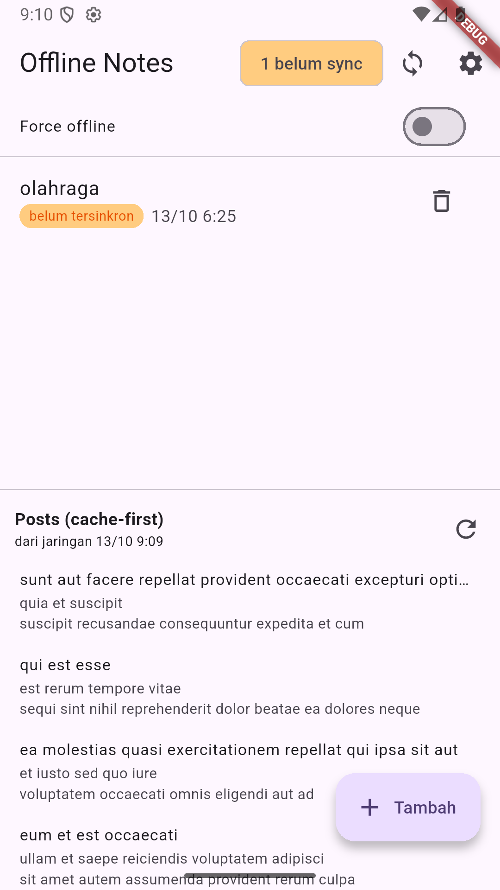
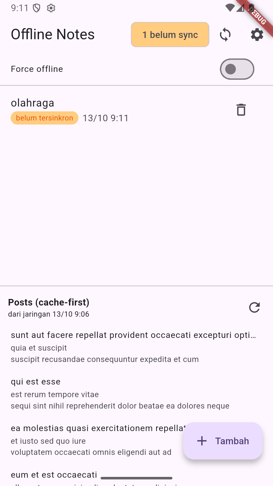

# Minggu 7 — Clean Architecture

### Tujuan

Merefactor aplikasi **Offline Notes** (project Minggu 5) menjadi **feature-first Clean Architecture**: memisahkan `presentation`, `domain`, dan `data` pada setiap fitur, dengan aturan dependensi hanya mengarah ke dalam. Tujuannya agar logika bisnis bisa diuji tanpa database, jaringan, maupun perangkat.

Refactor dikerjakan di folder ini — folder Minggu 5 dibiarkan utuh sebagai pembanding before/after.

### Fitur Utama

Aplikasi catatan offline-first: catatan tetap bisa dibaca dan ditulis tanpa internet, lalu disinkronkan saat online.

- Preferensi tema gelap/terang dan waktu terakhir dibuka (SharedPreferences)
- CRUD catatan persisten (SQLite), diurutkan `updated_at` terbaru
- Badge "belum tersinkron" per baris dan chip ringkasan antrean
- Antrean sinkronisasi yang menandai bersih **per catatan**, setelah "server" menerimanya
- Cache-first read untuk daftar posts, lengkap dengan label asal data
- Toggle Force offline untuk demo deterministik
- Halaman detail `/note/:id` dan empat state UI (loading, error, empty, success)

### Stack Teknologi

- Flutter 3.47.2 (Dart 3.13.2) 
- flutter_riverpod 3.4.3 untuk state dan dependency injection
- go_router 18.0.2 
- sqflite 2.4.4+1 
- shared_preferences 2.5.6 
- dio 5.11.1 
- flutter_test.

### Cara Menjalankan

```bash
cd 07-week-7-clean-architecture
flutter pub get
flutter run
```

Pemeriksaan: `flutter analyze` (0 issues) dan `flutter test` (13 test).

---

## Analisis Sebelum Refactor

### Peta File ke Layer

Seluruh kode masih berada di `lib/{data, pages, widgets}` — **tidak ada layer `domain` sama sekali**.

`lib/data/local/note.dart` dan `lib/data/models/post.dart` masing-masing adalah entity **sekaligus** model, karena `toMap`/`fromMap`/`toJson` menempel di dalamnya. `lib/data/repositories/note_repository.dart` dan `post_repository.dart` adalah implementasi **tanpa interface**, sehingga tidak ada kontrak yang bisa dipalsukan saat test. `lib/data/sync.dart` menyimpan `syncNotes()` yang justru memegang aturan bisnis (urutan antrean, penandaan per baris). Dan `lib/data/providers.dart` menampung DI beserta seluruh notifier, padahal itu state presentasi.

Di sisi tampilan, aturan bisnis menyelinap ke widget: `note_detail_page.dart` membentuk `Note(...)` lengkap dengan `dirty: true` dan `updatedAt: now`, sementara `settings_page.dart`, `notes_page.dart`, dan `note_tile.dart` masing-masing menyusun format tanggal sendiri. `main.dart` membuat `PrefsRepository()` sendiri, bukan menerimanya dari provider.

`lib/router.dart`, `lib/data/local/db.dart`, `lib/data/prefs.dart`, dan `lib/data/api_client.dart` tidak bermasalah.

### Pelanggaran yang Ditemukan

Tiga pemeriksaan dari codelab dijalankan pada `lib/pages`, `lib/widgets`, dan `lib/main.dart`.

**Presentation menyentuh platform langsung** — pola `Dio(`, `openDatabase`, `getDatabasesPath`, `SharedPreferences.getInstance`, `jsonDecode` memberi **0 hasil**. Repository dan provider dari Minggu 5 sudah menjaga batas ini.

**Logika dan pemformatan di presentation** — **3 berkas**: `settings_page.dart` (`tryParse` lalu menyusun `dd/mm/yyyy`), `notes_page.dart` (stempel waktu untuk label "dari cache 12/10 13:31"), dan `note_tile.dart` (`_formatTime`). Aturan tampilan tanggal disalin tiga kali, padahal seharusnya jadi fungsi murni yang bisa diuji tanpa widget.

**Instansiasi manual** — **1 pelanggaran**: `main.dart` memanggil `PrefsRepository()` langsung. Baris itu berjalan sebelum `ProviderScope` ada, jadi tidak ada container untuk membacanya — tapi tetap pelanggaran, karena tidak ada kontrak yang bisa diganti saat test.

### Struktur Target

```
lib/
├── core/                    # murni Dart — tanpa Flutter, Dio, sqflite
│   ├── failures.dart        # Failure: LocalFailure, NetworkFailure
│   └── format.dart          # fungsi murni: format tanggal
├── data/
│   └── local/db.dart        # infrastruktur bersama: satu file database
├── shared/
│   └── providers.dart       # flag demo lintas fitur: force offline
├── features/
│   ├── notes/{domain, data, presentation}
│   ├── posts/{domain, data, presentation}
│   └── preferences/{domain, data, presentation}
├── main.dart
└── router.dart
```

Arah dependensi hanya satu: `presentation` bergantung pada `domain`, dan `data` mengimplementasikan `domain`. `domain` tidak mengimpor Flutter, Dio, sqflite, maupun shared_preferences. Fitur berkomunikasi lewat rute, bukan dengan saling mengimpor halaman.

### Use Case: Mana yang Layak

Codelab memperingatkan *over-engineering*: use case untuk setiap CRUD satu baris hanya menambah lapisan kosong. Aturan yang dipakai di sini: **use case dibuat hanya bila ia memegang aturan.**

Jadi ada use case untuk `AddNote` (judul tidak boleh kosong, catatan baru wajib bertanda `dirty`), `UpdateNote` (`updatedAt` diisi waktu sekarang dan `dirty` diset), `SyncNotes` (urutkan antrean dari yang terlama, tandai bersih per baris), dan `LoadPostsCacheFirst` (urutan cache → jaringan → timpa cache).

Tidak ada use case untuk `GetNotes`, `GetNoteById`, dan `DeleteNote` — ketiganya tidak punya aturan tambahan, jadi notifier memanggil repository langsung. Efeknya bukan sekadar lebih ringkas: test jadi menguji aturan yang nyata.

> Catatan terbuka: contoh di codelab memakai `GetNotes` sebagai use case, sementara checklist verifikasinya sendiri menyebut pola itu over-engineering. Codelab tidak konsisten di titik ini; di sini keputusannya mengikuti checklist.

---

## Refactor yang Dikerjakan

Entity dipisah dari mapping: `data/local/note.dart` menjadi `features/notes/domain/entities/note.dart` (murni) dan `features/notes/data/models/note_model.dart` (satu-satunya tempat mapping). Hal yang sama dilakukan untuk `Post`.

Implementasi konkret dipisah dari kontraknya: interface kini hidup di `domain/repositories/`, sedangkan `NoteRepositoryImpl` (SQLite), `PostRepositoryImpl` (Dio), dan `PostsCacheImpl` (SQLite) tinggal di `data/repositories/`.

Aturan bisnis naik ke domain. `syncNotes()` menjadi use case `SyncNotes`, dan cara sebuah catatan dibentuk saat ditambah atau diubah kini ditentukan `AddNote` dan `UpdateNote` — bukan oleh widget. Repository hanya menyimpan apa adanya.

Provider catatan pindah ke `features/notes/presentation/providers/`, halaman dan widget pindah ke folder fiturnya, dan bagian posts dikeluarkan dari halaman catatan menjadi `posts_section.dart`.

Formatting tanggal di tiga tempat digantikan `core/format.dart`. DI di `main.dart` diperbaiki: pencatatan waktu buka kini lewat provider.

Fitur kedua dan ketiga ikut dibersihkan agar tidak ada yang tertinggal: `posts` mendapat entity, dua interface, dua implementasi, satu use case, dan widget-nya sendiri; `preferences` mendapat interface, implementasi SharedPreferences, provider, dan halaman pengaturan. Flag `forceOffline` dipindah ke `shared/providers.dart` karena ia memengaruhi dua fitur sekaligus.

Setelah refactor, `lib/data/` hanya menyisakan `local/db.dart` — infrastruktur bersama, karena satu file database dipakai tabel `notes` dan `cached_posts`.

### Verifikasi Aturan Dependensi

Presentation steril dari data mentah di ketiga fitur: **0 hasil**. Domain steril dari framework di ketiga fitur dan `core/`: **0 hasil**. `flutter analyze` bersih (0 issues) dan `flutter test` lulus 13 test.

Satu baris memang muncul bila pencarian pertama diperluas dengan pola `Dio(` atau `RepositoryImpl(`:

```dart
// features/posts/presentation/providers/posts_providers.dart
final postRepositoryProvider = Provider<PostRepository>(
  (ref) => PostRepositoryImpl(createPostDio()),
);
```

Itu bukan pelanggaran: berkas ini adalah *composition root*, satu-satunya tempat implementasi konkret dipasang. Hal yang sama berlaku untuk `NoteRepositoryImpl(openNotesDb)` dan `PreferencesRepositoryImpl()`.

---

## Hasil yang Dicapai

Aplikasi hasil refactor berjalan **identik** dengan sebelum refactor — itu syarat utama codelab minggu ini. Diverifikasi di emulator Android: daftar catatan, badge dirty, sync, cache-first, dan force offline semuanya bekerja.

### Screenshot: Sebelum vs Sesudah

**Sebelum refactor** — aplikasi dari folder Minggu 5:



**Sesudah refactor** — aplikasi dari folder Minggu 7:



Keduanya menampilkan layar yang identik: chip antrean "1 belum sync", catatan "olahraga" dengan badge "belum tersinkron", bagian Posts cache-first yang terisi, dan tombol Tambah. Yang berbeda hanya stempel waktu, karena keduanya aplikasi terpisah dengan datanya sendiri.

### Refleksi

**Mengapa interface repository harus tinggal di domain, bukan di data?**
> Karena arah dependensinya. Presentation membutuhkan kontrak untuk memanggil data; kalau kontrak itu tinggal di data, domain dan presentation harus mengimpor layer data — panah ketergantungan berbalik, dan logika bisnis jadi terikat pada SQLite atau Dio. Dengan interface di domain, justru layer data yang bergantung pada domain. Itu terbukti saat test: repository palsu cukup mengimplementasikan interface, dan tidak satu pun use case perlu diubah.

**Kapan use case benar-benar dibutuhkan, dan kapan repository langsung ke notifier sudah cukup?**
> Use case layak ketika operasi itu memegang aturan — sesuatu yang harus benar terlepas dari UI mana yang memanggilnya. Di sini: `AddNote`, `UpdateNote`, `SyncNotes`, dan `LoadPostsCacheFirst`. Sebaliknya `GetNotes`, `GetNoteById`, dan `DeleteNote` tidak punya aturan apa pun, jadi use case untuk ketiganya hanya menambah lapisan kosong.

**Apa biaya over-engineering bagi tim kecil, dan kapan biayanya sepadan?**
> Setiap operasi baru melewati beberapa berkas sekaligus, dan pembaca harus melompat-lompat untuk memahami satu alur. Untuk CRUD sederhana itu memperlambat tanpa menambah keamanan. Biayanya baru sepadan ketika aturan mulai berlipat — konflik data, kebijakan cache, atau aturan yang harus konsisten di banyak tempat. Di project ini `notes` memang punya aturan seperti itu; `preferences` tidak, jadi di situ saya tidak memaksakan use case.

**Bagian mana dari usulan AI yang ditolak atau disederhanakan, dan mengapa?**
> Dua hal, keduanya tercatat di `docs/ai-challenge.md`: use case untuk setiap CRUD satu baris (ditolak — hanya jadi lapisan kosong), dan mapping `toMap`/`fromMap` di dalam entity (ditolak — entity harus bisa dipakai tanpa menyentuh storage). Selain itu saya memperbaiki satu pelanggaran yang tidak disebut AI: `main.dart` membuat repository langsung di luar provider.
